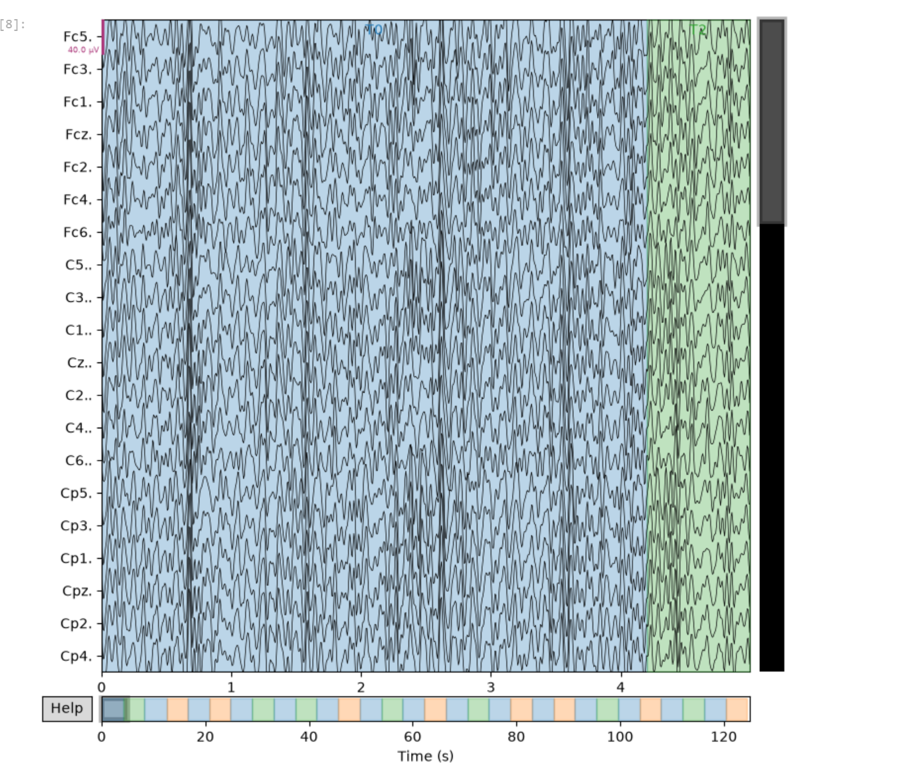

# MI-EEG-baseline
这是我的第一个关于BCI的兴趣小项目，打算用公开的数据去学习用Python处理EEG数据

## 我的目标
对我未来学习BCI以及相关领域，做相关BCI及相关领域的科研提供一定的基础

## 声明
本次项目使用了AI 辅助我学习代码相关的知识以及readme的编辑等，具体代码基本为本人自己边学边写，可能会有AI生成的代码

## 数据来源与致谢
本项目使用了 PhysioNet 提供的 **EEG Motor Movement/Imagery Dataset** (version 1.0.0) 进行运动想象分类练习。
- 数据下载地址：https://physionet.org/content/eegmmidb/1.0.0/
- 引用：Schalk, G. (2009). EEG Motor Movement/Imagery Dataset. PhysioNet. https://doi.org/10.13026/C28G6P
- 感谢 BCI2000 系统开发者及 PhysioNet 平台提供公开数据。

## 实验进展 (Day 1)
- [x] 下载并加载 PhysioNet EEGBCI 数据集。
- [x] 成功绘制原始 EEG 信号图。
- [x] 应用 8-30Hz 带通滤波去除噪音。
- [ ] 下一步：提取特征 (CSP) 和分类 (LDA)。
第一天里面的代码我基本是照着AI写的那样照葫芦画瓢写的
## 结果展示

- [x] 提取事件标记并切分数据 (Epoching)。
- [x] 计算所有切片的平均脑电波形 (Average ERP)。
- [ ] 下一步：提取特征 (CSP) 和分类 (LDA)。
依旧照猫画虎
## 实验结果：平均脑电波形

